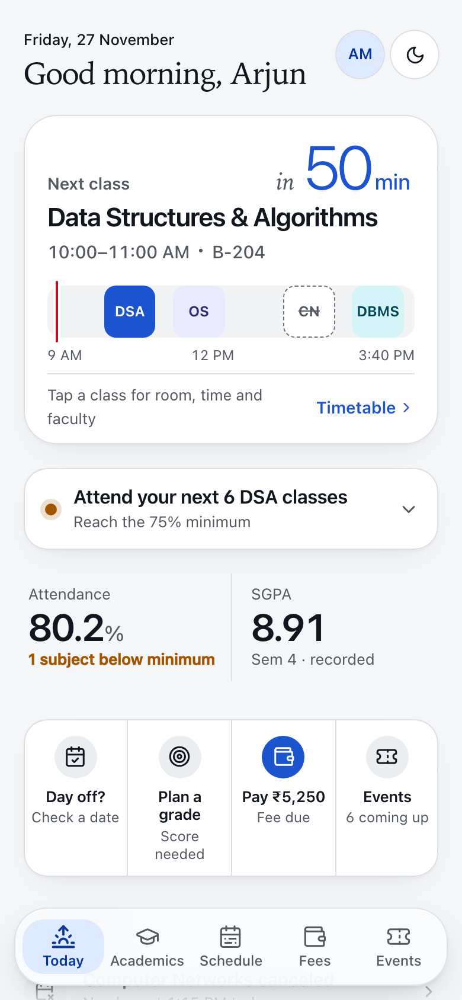
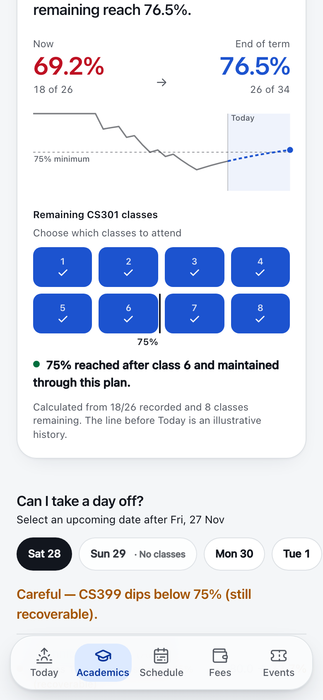
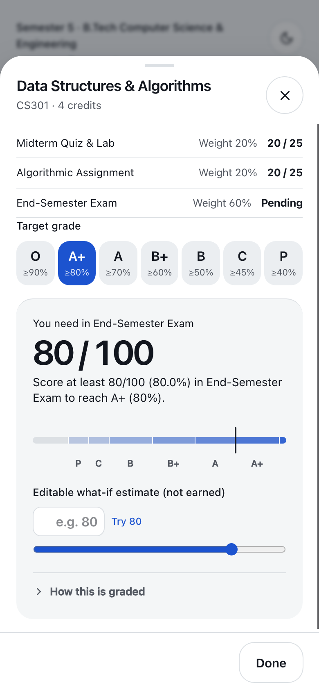
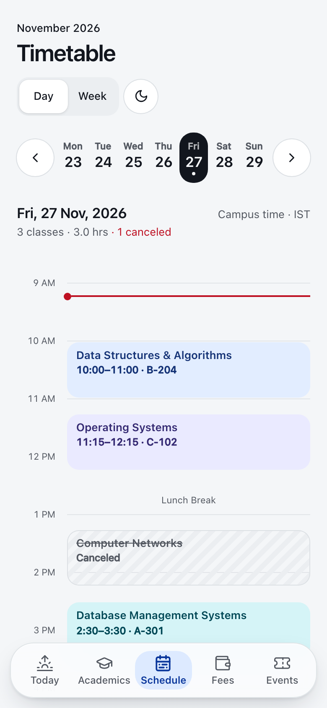
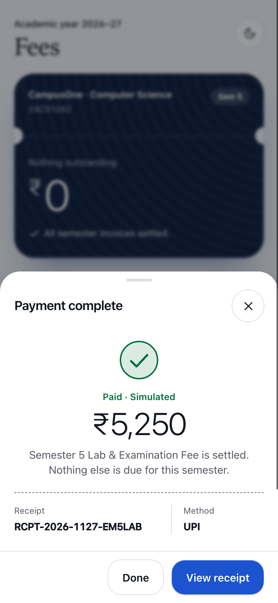

<p align="left">
  
</p>

# CampusOne

**Everything campus. In one place.**

Student workspace built by **Team NexaCoders** (Solo participant) for **Pixelcraft 2026 UI/UX Design Challenge — DS-05**.

> **Demo notice:** CampusOne runs on fictional academic, schedule, financial, and event fixtures anchored to a fixed demonstration clock (`27 November 2026, 09:10 IST`, student `Arjun Menon · 24CS1042`). Payments and event registrations are simulated in browser `localStorage` with no backend service, authentication, or real money movement.

---

## Problem

Routine student workflows are commonly split across disconnected portals for attendance logs, grade sheets, daily timetables, fee receipts, and event announcements. Students rarely need another passive chart—they need direct answers to immediate questions: *Which class starts next? How many classes must I attend consecutively to recover 75%? Which upcoming sequence keeps me above 75%? What exam score secures my target grade?*

## Core experience

CampusOne organizes student life into six connected screens pairing editorial serif headings (`--font-serif`) with tabular sans-serif academic figures (`--font-sans`), OKLCH Porcelain & Cobalt tokens, shared domain fixtures, and pure TypeScript calculation contracts:

- **Today** — Simplified interactive daily companion: compact one-line serif greeting, porcelain next-class hero with countdown (`in 50 min`), tappable duration-proportional class strip opening inline `Schedule preview` rows (stacking chronologically at `320px` and `200%` text enlargement), expandable attendance insight, quiet Attendance (`80.2%`) and recorded Sem 4 SGPA (`8.91`) links, one grouped quick-action surface (`Day off?`, `Plan a grade`, contextual cobalt-accented `Pay ₹5,250` → `Receipts`, `Events`), `Also today` reminders, and `Around campus` event previews.
- **Academics · Attendance** — Answer-first recovery planner featuring an interactive numbered class register (explicit attend/skip check & cross toggles, `75%` finish flag only on sustained crossings, accurate deficit wording across all 256 `CS301` combinations), `Now` / `End of term` counts (`18 of 26` → `26 of 34`), trajectory chart, native `<Dialog>` target stepper (`75%`–`100%`), subject dot-plot field, and future-only **Day-off checker** (`?focus=day-off`).
- **Academics · Marks** — Grouped subject ledger with Sem 5 primary progress (`Complete marks for 2 of 4 subjects` + segment meter) vs recorded `Sem 4` `8.91`, zero-credit `CS399` audit separation, seven single-row target grade chips (`O`–`P`, `4+3` zoom reflow), `ExamScale` banded ruler, and live `What-if` slider (`Try 80`).
- **Timetable** — Proportional subject-tinted vertical timeline (`08:00`–`18:00`) with `9:10` red time chip, explicit canceled-class hatching (`Computer Networks`), Day/Week switcher (`No classes` Sunday column), `<Dialog>` Class Sheet, and narrow/zoom agenda fallback.
- **Fees & Payments** — Perforated dark-navy **Financial Pass** leading with `₹5,250` light numeral, raised currency sign, and explicit `Mon, 30 Nov, 2026` (`3 days remaining`) deadline, itemized invoice list, simulated checkout with `Demo controls` (**Decline** / **Retry** / **Success**), reduced-motion-safe completion mark + plain balance summary + receipt stub, and `View latest receipt` lookup (`RCPT-*`).
- **Campus Events** — Six original editorial SVG + typographic poster artworks (`SYS / 01`–`ZIN / 06`), compact side-by-side mobile featured spotlight, horizontally scrollable category filters (`All`, `Technical`, `Career`, `Academic`, `Cultural`, `Saved`), search, bookmarking, and persistent demo registrations.

## Demo & controls

- **Live production URL:** [https://campusone-pi-flax.vercel.app](https://campusone-pi-flax.vercel.app)
- **GitHub repository:** [https://github.com/abbasahamed/CampusOne](https://github.com/abbasahamed/CampusOne)
- **Release summary:** [Release notes](docs/RELEASE.md)
- **Theme switcher:** Open the top-right `AM` avatar or Moon/Sun quick toggle to switch `System`, `Light`, or `Dark`.
- **Payment simulator:** Open `Review payment -> Demo controls` on `/fees` to test simulated **Decline** (retaining unpaid balance), **Retry**, and **Success** (settling the invoice, displaying the receipt stub, and switching Today's quick action to `Receipts`).
- **Deep links:** Routes preserve query context (`/schedule?date=2026-11-27&view=day`, `/academics/attendance?subject=off-sem5-cs301`, `/academics/attendance?focus=day-off`, `/academics/marks?semester=sem-4`, `/fees?invoice=inv-sem5-lab`, `/events?event=evt-print-lab-26`).

## Technical setup

Built with React 19, strict TypeScript, React Router, Vite, Tailwind CSS v4, Lucide icons, and bundled Inter Variable. Runs with zero backend dependencies.

```bash
npm install
npm run dev
```

Verification and production build scripts:

```bash
npm run typecheck   # tsc -b --noEmit
npm run lint        # eslint .
npm test            # node --test src/domain/*.test.ts
npm run build       # tsc -b && vite build
npm run preview     # serve built dist/ locally
```

## Accessibility & known limitations

- **Implemented & inspected:** Pre-paint theme selection (`System / Light / Dark`), semantic landmarks (`<main>`, single `<h1>`, `aria-label` nav), native modal `<Dialog>` focus management (`Escape` dismissal, trigger focus restoration), high-contrast frosted floating dock (`68.8×46px` equal capsules, adaptive `Menu` sheet under `320px`/`360px` or `200%` text enlargement), `>= 55.84 × 48` CSS px numbered register controls, `prefers-reduced-motion` support across animations and completion checkmarks, verified Timetable contrast (`>= 6.39:1`), and `320px`–`1440px` reflow with zero horizontal overflow.
- **Explicit limitations:** Verification was conducted in headless desktop Chrome DevTools Protocol across emulated mobile/desktop viewports (`320px`–`1440px`) and `200%` CSS root font enlargement. Physical mobile hardware (iOS/Android), Safari/Firefox cross-browser engines, actual browser zoom, interactive VoiceOver/NVDA walkthroughs, and external social-preview crawlers were not executed. This is not a claim of full WCAG certification.

## Design, architecture & attribution

- **Project specs:** [Product](docs/PRODUCT.md) · [Design system](docs/DESIGN.md) · [Architecture](docs/ARCHITECTURE.md) · [Roadmap](docs/ROADMAP.md) · [Status](docs/STATUS.md) · [Attribution](docs/ATTRIBUTION.md)
- **Libraries & assets:** React & React DOM (MIT), React Router DOM (MIT), Lucide Icons (ISC), `@fontsource-variable/inter` (OFL-1.1), Tailwind CSS (MIT), Vite (MIT), TypeScript (Apache-2.0). Original CampusOne gate mark, social card (`public/og-image.png`), attendance visualizations, and six event poster artworks authored for this submission.
- **AI & design guidance disclosure:** Built with **OpenAI Codex** (Phases 00–03/06, Phase 12 case study, and Phase 13B verification/fixes), **Vercel v0 + Claude Opus 5.5**, **Claude Code Opus** (Phases 11, 11A.1, and 13 refinement consulting `unslop` by Damir Sokolovsky [CC BY 4.0] in polish mode without running scripts, plus Laws of UX), and **Antigravity (`Gemini 4 Hydrogen`)** across core implementation, Phase 10B/11B/14A–B integration, verification, and release engineering. Full provenance is documented in [Attribution](docs/ATTRIBUTION.md). No project-wide open-source license has been assigned by the owner.

## Final screenshots

<table>
  <tr>
    <td></td>
    <td></td>
    <td></td>
  </tr>
  <tr>
    <td align="center"><strong>Today</strong></td>
    <td align="center"><strong>Attendance Register</strong></td>
    <td align="center"><strong>Marks Planner</strong></td>
  </tr>
  <tr>
    <td></td>
    <td></td>
    <td></td>
  </tr>
  <tr>
    <td align="center"><strong>Timetable</strong></td>
    <td align="center"><strong>Fees Settlement</strong></td>
    <td align="center"><strong>Campus Events</strong></td>
  </tr>
</table>
