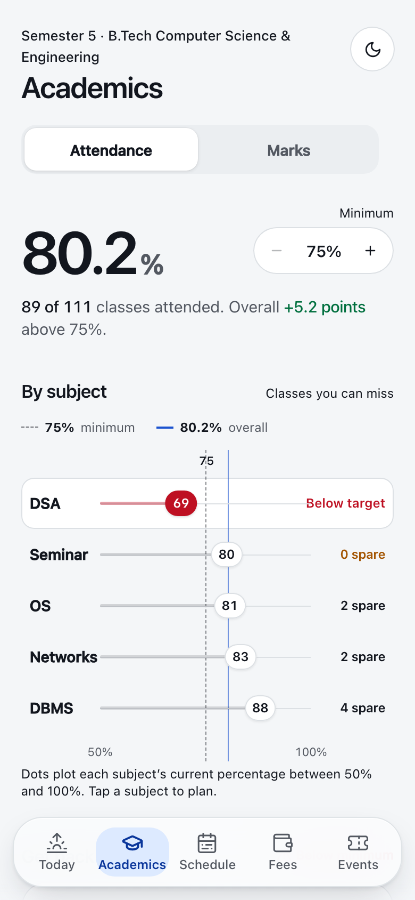
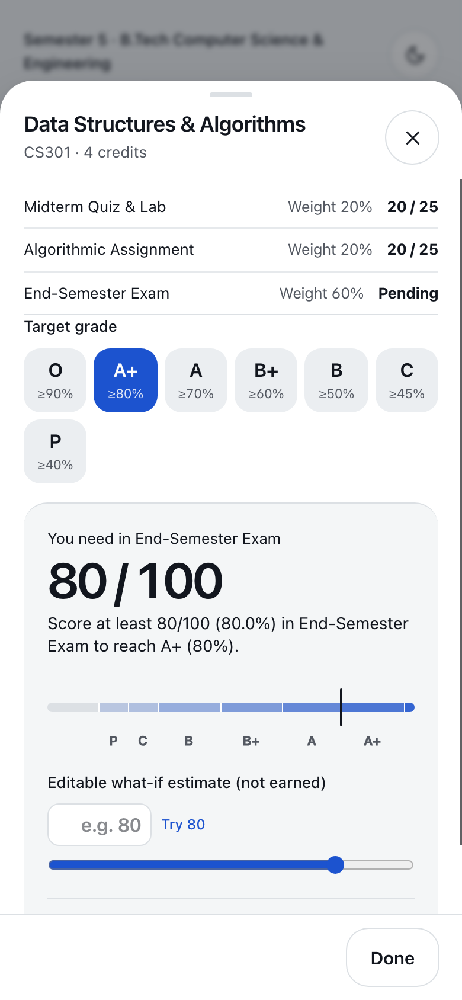
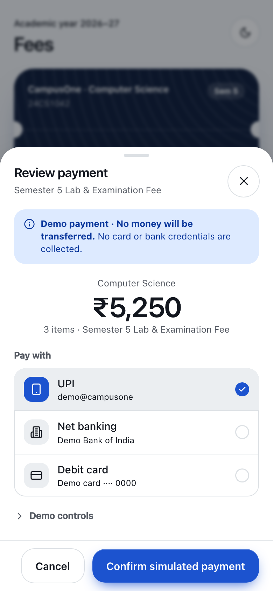
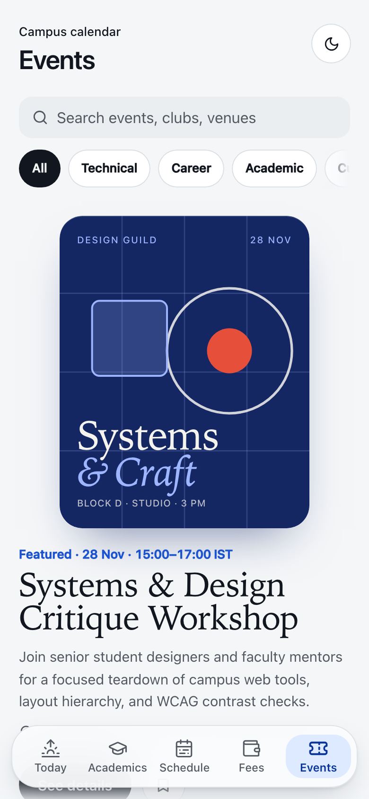

<p align="left">
  
</p>

# CampusOne

**Everything campus. In one place.**

Student workspace built by **Team NexaCoders** (Solo participant) for **Pixelcraft 2026 UI/UX Design Challenge — DS-05**.

> **Demo notice:** CampusOne runs on fictional academic, schedule, financial, and event fixtures anchored to a fixed demonstration clock (`27 November 2026, 09:10 IST`, student `Arjun Menon · 24CS1042`). Payments and event registrations are simulated in browser `localStorage` with no backend service, authentication, or real money movement.

---

## Problem

Routine student workflows are commonly split across disconnected portals for attendance logs, grade sheets, daily timetables, fee receipts, and event announcements. Students rarely need another passive chart—they need direct answers to immediate questions: *Which class starts next? How many classes must I attend consecutively to recover 75%? If I skip Saturday, will any subject drop below 75%? What exam score secures my target grade?*

## Core experience

CampusOne organizes student life into six connected screens backed by an OKLCH visual system, shared TypeScript domain fixtures, and pure calculation contracts:

- **Today** — Split Cobalt live-clock countdown class ticket (`min`) paired with the day timeline, semantic Attendance (`89 of 111 classes attended`) + recorded Sem 4 SGPA (`8.91`) vitals, concise single-line priority action queue, and upcoming events.
- **Academics · Attendance** — Subject dot-plot field against a shared `75% minimum` reference rule (`80.2% overall`), native `<Dialog>` minimum target stepper (`75%`–`100%`), SVG trajectory chart, interactive `Recover / Safe misses / What if?` planner (`CS301` shows `6` consecutive classes needed across `8` remaining sessions; switching to `85%` demonstrates an unreachable plan), and a future-only **Day-off checker** classifying absences as safe, deficit-recoverable, or unreachable.
- **Academics · Marks** — Semester-switchable SGPA (`Sem 5` in progress with graded coverage vs recorded `Sem 4` `8.91`, zero-credit `CS399` audit excluded), `ExamScale` banded score ruler, live `What-if` slider + editable numeric input (`Try 80`), and required-score target grade planner (`O`–`P`).
- **Timetable** — Proportional subject-tinted vertical timeline (`08:00`–`18:00`) with high-contrast past-class tinting, live `09:10 IST` needle, Day/Week switcher (explicit `No classes` Sunday column), `<Dialog>` Class Sheet details, and narrow/zoom agenda fallback.
- **Fees & Payments** — Perforated dark-navy **Financial Pass** leading with `₹5,250` balance due and explicit `Mon, 30 Nov, 2026` (`3 days remaining`) deadline, itemized fee breakdown, simulated checkout sheet with `Demo controls` (**Decline** / **Retry** / **Success**), clear no-transfer notice, and persistent `localStorage` receipts (`RCPT-*`).
- **Campus Events** — Six original editorial SVG + typographic poster artworks (`SYS / 01`–`ZIN / 06`), compact featured spotlight, horizontally scrollable category filter rail (`All`, `Technical`, `Career`, `Academic`, `Cultural`, `Saved`), search, bookmarking, and persistent demo registrations.

## Demo & controls

- **Live production URL:** [https://campusone-pi-flax.vercel.app](https://campusone-pi-flax.vercel.app)
- **GitHub repository:** [https://github.com/abbasahamed/CampusOne](https://github.com/abbasahamed/CampusOne)
- **Release summary:** [Release notes](docs/RELEASE.md)
- **Theme switcher:** Open the top-right `AM` avatar on mobile Today or the desktop sidebar footer row to toggle `Light` / `Dark`, or select `System`.
- **Payment simulator:** Open `Review payment -> Demo controls` on `/fees` to test simulated **Decline** (retaining unpaid balance), **Retry**, and **Success** (settling the invoice and clearing Today's fee reminder).
- **Deep links:** Routes preserve query context (`/schedule?date=2026-11-27&view=day`, `/academics/attendance?subject=off-sem5-cs301`, `/academics/marks?semester=sem-4`, `/fees?invoice=inv-sem5-lab`, `/events?event=evt-design-systems-26`).

## Technical setup

Built with React 19, strict TypeScript, React Router, Vite, Tailwind CSS v4, Lucide icons, and bundled Inter Variable. Runs with zero backend dependencies.

```bash
npm install
npm run dev
```

Verification and production build scripts:

```bash
npm run typecheck   # tsc -b --noEmit
npm run lint        # eslint .
npm test            # node --test src/domain/*.test.ts
npm run build       # tsc -b && vite build
npm run preview     # serve built dist/ locally
```

## Accessibility & known limitations

- **Implemented & inspected:** Pre-paint theme selection (`System / Light / Dark`), semantic landmarks (`<main>`, single `<h1>`, `aria-label` nav), native modal `<Dialog>` focus management (heading focus, `Escape` dismissal, trigger focus restoration), high-contrast frosted floating dock with bottom scrim and automatic `Menu` sheet fallback under `320px`/`360px` or `200%` root font scaling, verified contrast ratios on light/dark Timetable past blocks (`>= 6.61:1`), `prefers-reduced-motion` support, and `320px`–`1440px` reflow with zero horizontal overflow.
- **Explicit limitations:** Verification was conducted in headless desktop Chrome DevTools Protocol across emulated mobile/desktop viewports (`320px`–`1440px`), `200%` CSS root font enlargement, and `2x` viewport scaling. Physical mobile hardware (iOS/Android), Safari/Firefox cross-browser engines, and interactive VoiceOver/NVDA screen-reader walkthroughs were not executed. This is not a claim of full WCAG certification.

## Design, architecture & attribution

- **Project specs:** [Product](docs/PRODUCT.md) · [Design system](docs/DESIGN.md) · [Architecture](docs/ARCHITECTURE.md) · [Roadmap](docs/ROADMAP.md) · [Status](docs/STATUS.md) · [Attribution](docs/ATTRIBUTION.md)
- **Libraries & assets:** React & React DOM (MIT), React Router DOM (MIT), Lucide Icons (ISC), `@fontsource-variable/inter` (OFL-1.1), Tailwind CSS (MIT), Vite (MIT), TypeScript (Apache-2.0). Original CampusOne gate mark, social card (`public/og-image.png`), attendance visualizations, and six event poster artworks authored for this submission.
- **AI & design guidance disclosure:** Built across specifications, engineering, visual integration (`Vercel v0 + Claude Opus 5.5` exploration in `project.zip`), independent reviews, and verification using **OpenAI Codex (`GPT-6.2 Sol`)** and **Antigravity (`Gemini 4 Hydrogen`)**. Full provenance is documented in [Attribution](docs/ATTRIBUTION.md). No project-wide open-source license has been assigned by the owner.

## Final screenshots

<table>
  <tr>
    <td></td>
    <td></td>
    <td></td>
  </tr>
  <tr>
    <td align="center"><strong>Today</strong></td>
    <td align="center"><strong>Attendance</strong></td>
    <td align="center"><strong>Marks Planner</strong></td>
  </tr>
  <tr>
    <td></td>
    <td></td>
    <td></td>
  </tr>
  <tr>
    <td align="center"><strong>Timetable</strong></td>
    <td align="center"><strong>Fees Review</strong></td>
    <td align="center"><strong>Campus Events</strong></td>
  </tr>
</table>
